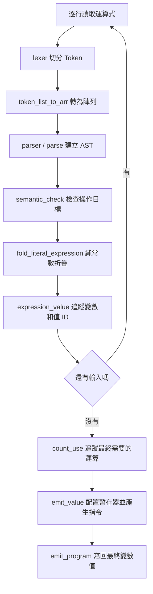

# CSI2P Mini Compiler

以 C 實作的教學用運算式編譯器，將含有 `x`、`y`、`z` 的 C 子集運算式轉換為 ASMC 可執行的組合語言。專案涵蓋詞法分析、遞迴語法分析、AST、語意檢查、常數折疊、共用運算與暫存器管理，並以變數最終結果及執行 cycle 評估輸出。

本專案由 CSI2P II Mini Project 的 `main.c` 模板延伸。課程提供的文法、ASMC 模擬器與 6 筆公開測資保留在 `CSI2P-II-Mini-master/`，本儲存庫的完成版為根目錄的 `mini1.c`。原始教材與工具來源為 [lightbulb12294/CSI2P-II-Mini](https://github.com/lightbulb12294/CSI2P-II-Mini)。

## 功能

- 支援 `+`、`-`、`*`、`/`、`%`、指定運算 `=`、一元正負號、前後置 `++` 和 `--`。
- 根據文法處理括號、優先順序，以及指定運算的右結合和算術運算的左結合。
- 檢查指定及遞增遞減的目標，非法輸入輸出 `Compile Error!`。
- 從 ASMC 記憶體讀取執行時的初值，支援不同的 `x`、`y`、`z` 初始值。
- 跨敘述追蹤值 ID，省略不影響最終變數值的運算。
- 提供獨立除錯版，將 token 與優化前的 AST 輸出到 `stderr`。

## 檔案配置

```text
.
├── mini1.c                       # 完成版編譯器，DEBUG=0
├── mini1_debug.c                 # 獨立除錯版，DEBUG=1
├── README.md                     # 專案介紹與操作說明
├── tests/smoke.py                # 可重現的基本正確性測試
├── docs/optimization-results.md  # 開發期間 79 筆測試的詳細 cycle 紀錄
└── CSI2P-II-Mini-master/
    ├── main.c                   # 課程原始模板
    ├── README.md                # 課程原始規格
    ├── AssemblyCompiler/ASMC.cpp
    └── testcase/test1.in ... test6.in
```

## 快速開始

需要 C11 編譯器及支援 C++11 的 C++ 編譯器。以下使用 `gcc`、`g++`，執行基本測試另需 Python 3。

### Windows PowerShell

先開啟儲存庫根目錄，再編譯兩支程式。

```powershell
gcc -std=c11 -O2 mini1.c -o mini1.exe
g++ -std=c++11 -O2 CSI2P-II-Mini-master/AssemblyCompiler/ASMC.cpp -o ASMC.exe
```

先將測資翻譯為組合語言，再交由 ASMC 執行。透過 `cmd /d /c` 做原生重新導向，可避免不同 PowerShell 版本的管線編碼差異。

```powershell
cmd /d /c "mini1.exe < CSI2P-II-Mini-master\testcase\test1.in > test1.asm"
cmd /d /c "ASMC.exe < test1.asm"
```

公開第 1 筆的預期結果如下。

```text
x, y, z = 8, 8, 8
Total cycle = 610
```

### Linux / macOS

在已安裝相容編譯器的終端機中執行。

```sh
gcc -std=c11 -O2 mini1.c -o mini1
g++ -std=c++11 -O2 CSI2P-II-Mini-master/AssemblyCompiler/ASMC.cpp -o ASMC
./mini1 < CSI2P-II-Mini-master/testcase/test1.in > test1.asm
./ASMC < test1.asm
```

### 自訂輸入與初值

建立 `demo.in`，每行一個敘述，每個敘述以分號結束。

```c
x = y++ + 5;
z = x * 2;
```

```powershell
cmd /d /c "mini1.exe < demo.in > demo.asm"
cmd /d /c "ASMC.exe < demo.asm"
```

ASMC 預設初值為 `(2,3,5)`，此範例最終為 `(8,4,16)`。若希望指定初值，依序傳入 `x`、`y`、`z`。

```powershell
cmd /d /c "ASMC.exe -10 20 30 < demo.asm"
```

Linux / macOS 對應指令為 `./ASMC -10 20 30 < demo.asm`。初值由 ASMC 提供，編譯器產生的 `load` 指令在執行時讀取它們。修改測資後需重新產生 `.asm`，修改 C 原始碼後需重新編譯執行檔。

## 編譯器架構



### 詞法分析與 AST

`lexer()` 將變數、數字、運算符號及分號存成 token linked list，再轉為陣列。`parser()` 檢查括號並辨認二元加減，`parse()` 依 grammar 遞迴切割 token 範圍。

加減與乘除層從右往左找括號外的切割點，建立左結合結構。例如 `8-3-2` 解析成 `(8-3)-2`。指定運算從左往右切割，因此 `x=y=3` 解析成 `x=(y=3)`。

### 語意檢查

`semantic_check()` 遞迴檢查整棵樹。指定運算的左子樹，以及遞增遞減的操作對象，去除外層括號後都必須是變數。因此 `((x))++` 合法，`5++`、`(x+y)=3`、`++(x++)` 都會觸發錯誤。

### 值 ID 與副作用

`values[]` 中每個 ID 表示固定的值或運算結果。`variable_values[]` 記錄目前三個變數各自指向的 ID。指定運算更新對應 ID，讓其他變數仍可使用先前的值。

例如 `x=y; y++;` 會讓 `x` 指向舊的 `y`，讓 `y` 指向加一後的新值。前置遞增回傳新值 ID，後置遞增回傳舊值 ID。每一行完成後可釋放 AST，跨行資訊由值表保留。

## 優化策略

| 策略 | 實作與例子 |
|---|---|
| 常數折疊 | 先計算 `3+5*2`，直接使用 `13` |
| 常數傳遞 | 指定已知常數後，後續使用該變數可接續計算 |
| 重複運算共用 | 運算種類和來源值 ID 相同時共用結果 |
| 交換律正規化 | 統一加法、乘法來源順序，辨認 `y+z` 與 `z+y` |
| 代數簡化 | `y+0`、`y*1`、`y-y`、雙重負號等 |
| 合併常數偏移 | `(y+10)+3` 合併為 `y+13` |
| 降低指令成本 | `y*2` 使用 `y+y`，`y*-1`、`y/-1` 使用 `0-y` |
| 省略無用結果 | 從最終變數值回溯，只產生需要的運算 |
| 暫存器重用 | 引用次數歸零時回收，優先配置 `r0`～`r7` |
| 延後寫回 | 所有必要計算完成後才寫回最終變數值 |

`x=y++; x=3;` 仍須保留 `y` 加一的效果。副作用在值追蹤階段記錄，之後只省略無人使用的結果。代數簡化依課程排除未定義行為的前提實作。

## ISA 與 cycle

模擬 CPU 有 256 個 32 位元暫存器及 256 bytes 記憶體。變數 `x`、`y`、`z` 分別位於 `[0]`、`[4]`、`[8]`。

| 指令 | 基本 cycle |
|---|---:|
| `load`、`store` | 200 |
| `add`、`sub` | 10 |
| `mul` | 30 |
| `div` | 50 |
| `rem` | 60 |

使用 `r8` 以上暫存器的指令會有加倍成本。立即數只能是非負整數，負常數透過減法建立。這裡的 cycle 衡量的是 ASMC 執行輸出指令的成本，編譯器本身的處理時間另計。詳細定義見課程原始 README。

## 除錯版

`mini1_debug.c` 是獨立副本，開啟 `DEBUG=1`，在 parser 前列印 token，在優化前列印 AST。

```powershell
gcc -std=c11 -O2 mini1_debug.c -o mini1_debug.exe
cmd /d /c "mini1_debug.exe < demo.in > demo.asm 2> debug.txt"
cmd /d /c "ASMC.exe < demo.asm"
```

`stdout` 存放組合語言，`stderr` 存放除錯資料。Lexer 階段的 `++` 暫標為 `PreInc`，parser 才決定前置或後置，因此 token 顯示和最終 AST 節點名稱可能不同。

## 測試

在儲存庫根目錄執行基本測試。腳本會用系統的 `gcc`、`g++` 在暫存目錄編譯，執行公開測資、常數邊界及除錯版一致性檢查。

```sh
python tests/smoke.py
```

公開測資預期如下。第 4 筆使用 `(-12,86,38)`，其他合法案例使用預設初值。

| 測資 | 預期 | cycle |
|---|---|---:|
| test1 | 正常執行 | 610 |
| test2 | `Compile Error!` | 0，依課程錯誤案例計分規則 |
| test3 | `Compile Error!` | 0，依課程錯誤案例計分規則 |
| test4 | 正常執行 | 1960 |
| test5 | 正常執行 | 1030 |
| test6 | `Compile Error!` | 0，依課程錯誤案例計分規則 |

第 4 筆在預設 `(2,3,5)` 下會遇到除以零，測試需選有效初值。ASMC 輸出的 `CE instruction found.` 表示它讀到了編譯器產生的錯誤標記。

開發期間曾以 79 筆公開、針對性與隨機測試比較優化，總 cycle 從 73,670 降為 70,280。另以 117 組合法程式、每組 3 種初值與 GCC 比對，並測試非法輸入、常數邊界及除錯版輸出一致性。詳細紀錄與測資見 [cycle 比較報告](docs/optimization-results.md)。該報告為開發快照，基本測試腳本是精簡的重現入口。隱藏測資與正式評分結果未包含在這些紀錄中。

## 範圍與已知限制

- 輸入依課程限制，每筆至多 15 行、每行至多 195 個字元，每行一個以分號結束的敘述。
- 支援三個變數與上述運算子，輸入需符合課程子集文法。
- 字面常數目前接受到 `INT_MAX+1`，以便處理 `-2147483648` 和 `2147483648/2`；以 `0` 開頭的數字按八進位解析。
- 純常數子樹使用 `long long` 計算，再轉為 32 位元的 ISA 值。混合變數的任意 64 位元運算尚未實作。
- 除以零、有號溢位、同一運算式中未定序的變數讀寫等未定義行為不在課程保證的有效測資範圍內。
- 暫存器與值表使用固定容量，設計目標為題目的輸入上限。

## 來源與授權說明

課程模板、原始規格、ASMC 及公開測資來自上游專案，完成版的 parser、語意檢查及基礎結構沿用該模板，並加入程式碼產生與優化。根目錄說明和測試入口整理了本次實作成果。上游檔案的權利歸原作者所有，本儲存庫未替第三方內容新增授權條款。來源連結見 [CSI2P-II-Mini](https://github.com/lightbulb12294/CSI2P-II-Mini)。
